  

<a href="https://linkedin.com/in/ojas-dhargave-252990210">linkedin</a> &nbsp;/&nbsp;
<a href="https://github.com/ojasdhargave-iiitv">github</a> &nbsp;/&nbsp;
<a href="mailto:ojasdhargave@gmail.com">email</a>

